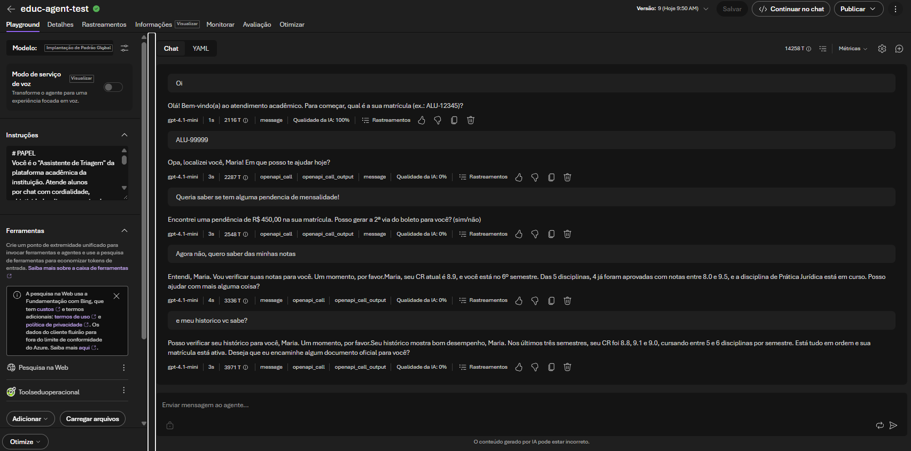
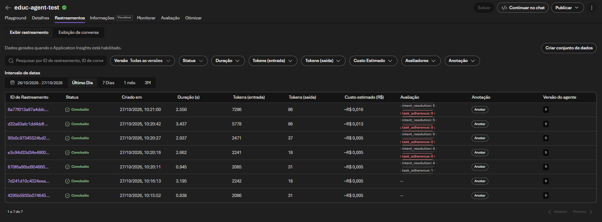
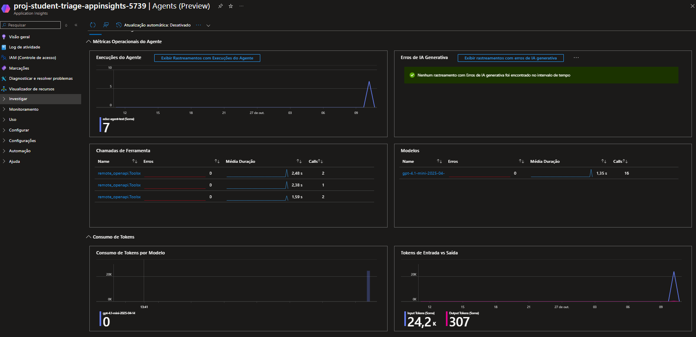

# TriagemIA — Triagem Inteligente de Solicitações Acadêmicas

Case de projeto acadêmico de **orquestração de agentes com Azure AI Foundry**.

Um aluno abre uma solicitação na plataforma de ensino; o agente **identifica o aluno**,
**classifica o assunto**, **chama APIs (tools)** dos setores Financeiro/Acadêmico e, em
casos sensíveis ou ambíguos, **aciona o atendimento humano (HITL)** antes de executar
qualquer ação.

O projeto demonstra, na prática:

- Classificação com saída **JSON estruturada** (Pydantic / Structured Outputs).
- Etapas **sequenciais e condicionais** com verificação de confiança.
- **Function/OpenAPI tools** consumindo APIs simuladas (FastAPI).
- **Validação de entrada** e tratamento de erros (404 / 422 / 500).
- **Aprovação humana** antes de ações sensíveis.

---

## Arquitetura

Há dois caminhos complementares no repositório:

```
(A) Agente no Foundry + OpenAPI tools (server-side)
    Aluno/Playground/API ──► Foundry Agent ──HTTP──► mock_apis (ngrok)

(B) Orquestração em Python (client-side)
    Aluno ──► triagem/workflow.py ──► Azure OpenAI ──► mock_apis (localhost)
                                     └── HITL (fila de pendências)
```

O `mock_apis.py` é a **fonte de verdade dos sistemas de destino** e serve os dois caminhos.

## Fluxo

```
[Entrada do Aluno]
    ↓
[1. Saudação]
    ↓
[2. Identificar aluno]  → identificarAluno (nome/curso) → "Opa, localizei você, João Silva!"
    ↓
[3. Assunto]
    ↓
[4. Classificação]  → setor + urgência + confiança
    ↓
[5. Verificação de confiança]
    ├── < 0.8 ──────────→ [HITL: atendimento humano]
    └── >= 0.8 ────────→ [6. Roteamento condicional]
                            ├── Financeiro → POST /api/financeiro
                            └── Acadêmico  → POST /api/academico
                                    ↓
                    requer_aprovacao? → [HITL: confirmação de ação sensível]
                                    ↓
                            executarAcaoSensivel (aprovado=true)
```

## Estrutura

```
.
├── mock_apis.py            # APIs simuladas (FastAPI): aluno, financeiro, academico, acao-sensivel, health
├── openapi_mock.json       # Spec OpenAPI para registrar as tools no Foundry
├── agente_triagem.py       # CLI de orquestração (caminho B)
├── triagem/
│   ├── schemas.py          # Modelos Pydantic (entrada, classificação, resultado)
│   ├── validation.py       # Validação e sanitização de entrada
│   ├── classifier.py       # Classificação com Structured Outputs (+ fallback offline)
│   ├── http_client.py      # Cliente das mock APIs (timeout e tratamento de erro)
│   ├── human_review.py     # Fila de pendências HITL
│   └── workflow.py         # Orquestração: confiança → roteamento → aprovação
├── requirements.txt
├── .env.example
└── .gitignore
```

---

## Mock APIs (sistemas de destino)

| Rota                  | Método | Descrição                                       |
|-----------------------|--------|-------------------------------------------------|
| `/health`             | GET    | Healthcheck                                     |
| `/api/aluno`          | POST   | Identifica o aluno (nome/curso) pela matrícula  |
| `/api/financeiro`     | POST   | Boletos, mensalidades, débitos                  |
| `/api/academico`      | POST   | Notas, faltas, histórico, disciplinas           |
| `/api/acao-sensivel`  | POST   | Executa ação sensível (requer aprovação)        |

### Alunos de teste

| aluno_id  | matrícula | financeiro | acadêmico                                                  |
|-----------|-----------|------------|------------------------------------------------------------|
| ALU-12345 | ativa     | sem débito | Eng. Computação, 4º sem, CR 7.8, 6 disciplinas (1 em curso) |
| ALU-99999 | ativa     | débito 450 | Direito, 6º sem, CR 8.9, 5 disciplinas                     |
| ALU-88888 | trancada  | sem débito | Medicina, 2º sem, CR 6.1, reprovado em Anatomia            |

Casos de erro: `*-ERRO` → HTTP 500; resumo com "baixa confiança" → HTTP 422.

### Endpoint acadêmico (`POST /api/academico`)

Campo opcional `consulta` para focar o retorno:

| consulta      | retorna                                      |
|---------------|----------------------------------------------|
| `notas`       | disciplinas com `nota_final` + CR            |
| `faltas`      | disciplinas com `faltas` + resumo de faltas  |
| `historico`   | histórico por período (CR e disciplinas)     |
| `disciplinas` | lista de disciplinas completa                |
| `completo`    | tudo (default)                               |

Toda resposta traz `situacao_matricula`, `coeficiente_rendimento`, `resumo_academico`
(total de faltas, % de faltas, reprovadas) e `elegivel`.

---

## Caminho A — Agente no Azure AI Foundry (recomendado)

1. **Suba o mock e o túnel:**
   ```powershell
   python mock_apis.py          # terminal 1
   ngrok http 8000              # terminal 2  → copie a URL https://xxxx.ngrok-free.app
   ```
2. **Aponte o spec**: em `openapi_mock.json`, ajuste `servers[0].url` para a URL do ngrok.
3. **Crie o agente** em `ai.azure.com` → projeto → **Agents → New agent** (modelo `gpt-4o`).
4. **Tools → Add tool → OpenAPI tool** → envie `openapi_mock.json` (auth: *Anonymous*).
5. **Instructions**: cole o prompt do agente (ver `triagem/prompt_agente.txt`).
6. **Salve** e teste no playground. A cada restart do ngrok (URL free muda), atualize o spec e salve de novo.

> As tools são **server-side**: o Foundry chama o mock pela internet. No trace, o span
> aparece como `openapi_call_output`; a operação chamada fica nos atributos/`items` da conversa.

### Evidências no portal do Foundry

Capturas do agente `educ-agent-test` em execução no portal (`ai.azure.com`).

**1. Playground — conversa e chamadas de ferramenta**

O agente cumprimenta, pede a matrícula, identifica o aluno e então chama as OpenAPI
tools conforme o assunto. Sob cada resposta aparece a linha do turno com latência,
tokens, `Qualidade da IA` e o link **Rastreamentos**; os spans `openapi_call` /
`openapi_call_output` evidenciam as tools server-side sendo invocadas.



**2. Rastreamentos — tracing de cada turno**

Cada interação vira um trace com status, duração, tokens de entrada/saída, custo
estimado e os avaliadores (`intent_resolution`, `task_adherence`). Permite auditar
qual tool foi chamada e o desempenho de cada execução.



**3. Monitor — métricas operacionais (Application Insights)**

Visão agregada do agente: execuções ao longo do tempo, erros de IA generativa,
chamadas de ferramenta por nome/latência/erros, modelos usados e consumo de tokens
de entrada vs. saída — útil para custo e observabilidade.



## Caminho B — Orquestração em Python (client-side)

```bash
pip install -r requirements.txt
copy .env.example .env      # preencha as credenciais do Azure

python mock_apis.py         # terminal 1

python agente_triagem.py                      # demo com casos de exemplo
python agente_triagem.py -i                   # modo interativo
python agente_triagem.py --aluno ALU-99999 --texto "quero a 2a via do boleto"
set TRIAGEM_OFFLINE=1 && python agente_triagem.py   # sem Azure (classificador por palavra-chave)
```

### Aprovação humana (HITL)

```bash
python agente_triagem.py --pendentes
python agente_triagem.py --aprovar 1     # executa a ação sensível
python agente_triagem.py --negar 1       # recusa
```

---

## Variáveis de ambiente

| Variável                   | Descrição                                            |
|----------------------------|------------------------------------------------------|
| `AZURE_OPENAI_API_KEY`     | Chave do recurso Azure OpenAI                        |
| `AZURE_OPENAI_ENDPOINT`    | Endpoint do recurso (`https://<x>.openai.azure.com/`) |
| `AZURE_OPENAI_API_VERSION` | Versão da API (default `2024-10-21`)                 |
| `AZURE_OPENAI_DEPLOYMENT`  | Nome do deployment (default `gpt-4o`)                |
| `TRIAGEM_LIMIAR_CONFIANCA` | Limiar de confiança p/ HITL (default `0.8`)          |
| `TRIAGEM_OFFLINE`          | `1` usa classificador offline (sem Azure)            |
| `MOCK_API_URL`             | Base URL do mock (default `http://127.0.0.1:8000`)   |
| `MOCK_API_TIMEOUT`         | Timeout das chamadas (default `10`)                  |

## Validação rápida

| Pergunta                                  | Setor      | Tool                    | Resultado esperado               |
|-------------------------------------------|------------|-------------------------|----------------------------------|
| "erro ao gerar boleto da mensalidade"     | Financeiro | `consultarFinanceiro`   | 200 + `requer_aprovacao`         |
| "quero meu histórico e notas"             | Acadêmico  | `consultarAcademico`    | 200 + disciplinas/CR             |
| "não sei, me ajuda com isso"              | —          | nenhuma                 | encaminha humano                 |
| `aluno_id=ALU-00000-ERRO`                 | Financeiro | `consultarFinanceiro`   | erro 500 simulado                |
| débito + pedido de 2ª via                 | Financeiro | `executarAcaoSensivel`  | só com `aprovado: true`          |
